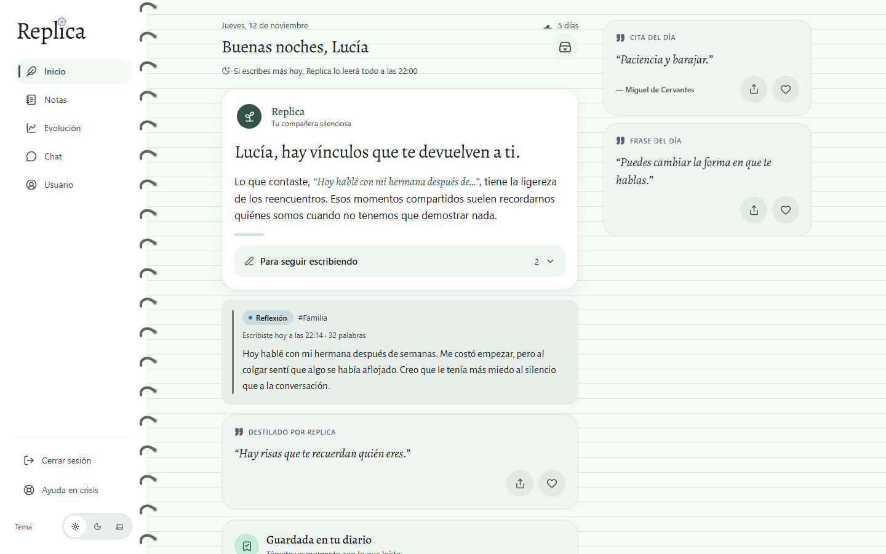
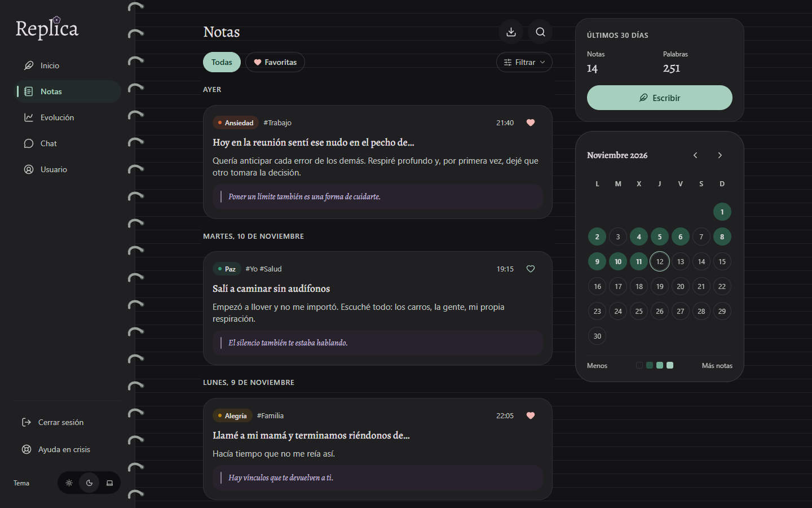
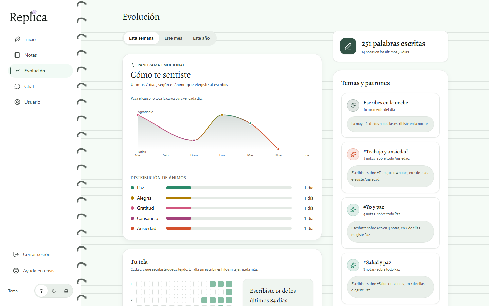
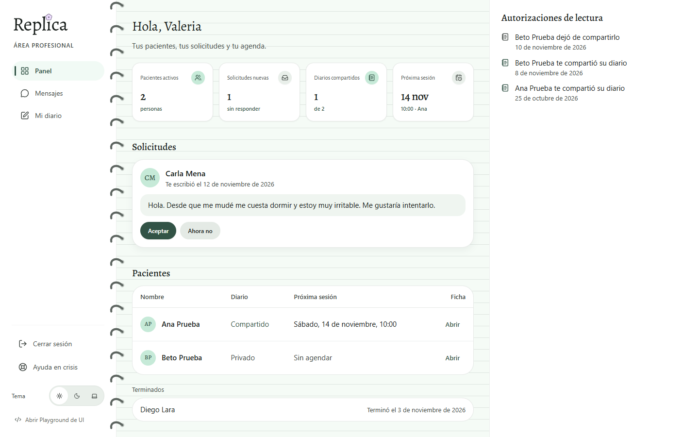
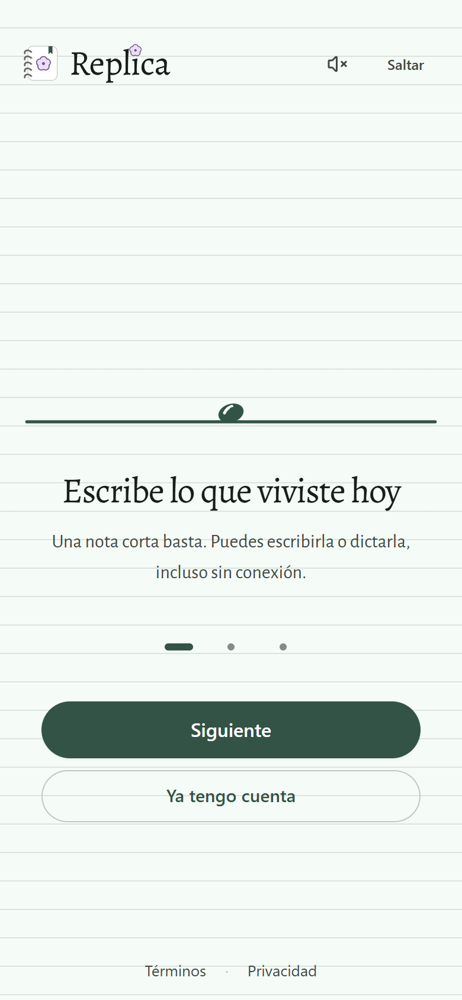
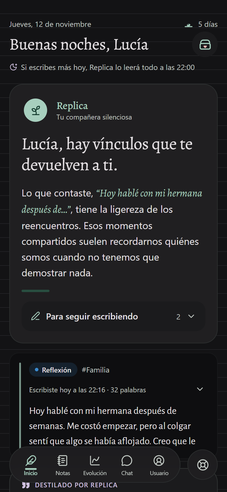

# Replica

[](https://github.com/Zstyles12/Proyecto-Replica/actions/workflows/ci.yml)

Un diario personal donde una IA responde a lo que escribes con una **réplica**: una reflexión breve y cálida que ayuda a seguir pensando. Incluye un canal con psicólogos verificados, que solo leen el diario si la persona lo autoriza.

**Demo:** https://proyecto-replica.vercel.app



| Notas, en tema oscuro | Evolución |
|---|---|
|  |  |

| Área profesional | En el teléfono |
|---|---|
|  |   |

Las capturas son de la web corriendo en local con los servicios simulados y datos de ejemplo.

> Proyecto universitario hecho por un solo desarrollador. La demo usa solo datos de prueba: no escribas en ella nada personal. Replica no reemplaza la atención profesional.

## Qué hace

- **Diario con réplica.** La primera nota del día recibe su réplica al momento. Las demás se guardan y las lee la réplica del día, a la hora que eligió la persona, con un comentario para cada una.
- **Notas privadas.** Una nota marcada como privada no la lee la IA ni el psicólogo.
- **Evolución.** Ánimo, temas y hábito de escritura por semana, mes o año, calculados solo con lo que la persona escribió o eligió.
- **Chat con la IA.** Una conversación aparte del diario, con límite diario. No diagnostica y, si detecta riesgo, deja de aconsejar y enlaza a la ayuda en crisis.
- **Psicólogos verificados.** Directorio, chat en tiempo real, sesiones por Google Meet y diario compartido con consentimiento explícito y revocable.
- **Área profesional.** Panel del psicólogo con sus pacientes y el diario que le compartieron, y un panel de administración que revisa las solicitudes de verificación.
- **En el navegador.** Se instala como PWA, guarda las notas escritas sin conexión y las envía al volver, manda un recordatorio diario con Web Push y se puede bloquear con PIN o llave de acceso.

## Con qué está hecho

| Parte | Tecnología |
|---|---|
| Interfaz | React 19, TypeScript estricto, Vite, React Router 7 |
| Estilos | Tailwind 3 con tokens propios de color y movimiento, tema claro y oscuro |
| Componentes | Propios, sin librería de componentes |
| Datos y cuentas | Supabase: Postgres, Auth, Storage y Realtime |
| Servidor e IA | Edge Functions de Supabase (Deno) que llaman a Gemini |
| Publicación | Vercel, con CSP y cabeceras de seguridad |

## Decisiones técnicas

- **El permiso lo da la base de datos.** Todas las tablas tienen Row Level Security. Lo que la persona no autorizó se filtra en el servidor: el psicólogo recibe solo las notas no privadas de quien le compartió su diario. Las guardas de la interfaz ordenan la navegación, no protegen datos.
- **La IA vive en el servidor.** El navegador nunca llama a Gemini ni conoce su clave: las réplicas y el chat salen de las Edge Functions. Los roles van en `app_metadata` y solo el servidor los cambia.
- **Cada servicio tiene una versión real y una simulada con el mismo contrato.** Sin variables de entorno, la web completa funciona en el navegador, sin backend.
- **Lo que no llegó al servidor no se muestra como hecho.** Una favorita o un ajuste que falla vuelve atrás, y una nota sin conexión queda en una bandeja que se reintenta.
- **Estado sin librerías.** Stores pequeños en TypeScript con `useSyncExternalStore`.
- **Los días se cuentan en hora local.** Con UTC, una nota escrita a las 21:00 en Venezuela caería en el día siguiente.
- **Accesibilidad.** Recorrido completo con teclado, foco visible, áreas táctiles de 44 px, contraste comprobado en claro y oscuro, y respeto a `prefers-reduced-motion`.
- **Contenido estricto.** CSP sin scripts en línea, fuentes alojadas en la propia web y HSTS.

## Probarlo en tu computadora

Necesitas Node 24.

```bash
cd frontend
npm install
npm run dev
```

Sin configurar nada más, la web usa los servicios simulados y guarda los datos en el navegador:

- Cualquier correo con una contraseña de 8 caracteres o más entra, y cualquier código de 6 dígitos confirma la cuenta.
- `valeria@replica.test` entra como psicóloga y `admin@replica.test` como administrador.

Para conectarla a un proyecto propio de Supabase, sigue [supabase/README.md](supabase/README.md).

## Estructura

```
frontend/            la web
  src/pages/         una pantalla por ruta
  src/features/      diario, notas, evolución, chat, cofre, perfil, área profesional
  src/components/    piezas base, movimiento, layout y marca
  src/services/      servicios reales y simulados
  src/lib/           sesión, fechas, bloqueo, sin conexión
supabase/
  migrations/        esquema, reglas de acceso y funciones de la base de datos
  functions/         Edge Functions: réplicas, chat con la IA, recordatorios, roles
docs/                diseño, producto, base de datos y plan de trabajo
```

## Documentación

- [docs/01-resumen.md](docs/01-resumen.md): qué es Replica y sus principios.
- [docs/DESIGN.md](docs/DESIGN.md) y [docs/DESIGN-WEB.md](docs/DESIGN-WEB.md): sistema de diseño, voz y pantallas.
- [docs/02-estructura.md](docs/02-estructura.md): stack, rutas y organización del código.
- [docs/03-base-de-datos.md](docs/03-base-de-datos.md): esquema, reglas de acceso y funciones de servidor.
- [docs/05-requisitos.md](docs/05-requisitos.md): estado de cada requisito de la especificación.

## Comprobaciones

```bash
npx tsc -p tsconfig.app.json --noEmit
npm run lint
npm run build
```

Las tres corren en cada push con GitHub Actions. El proyecto no tiene pruebas automatizadas de interfaz: los flujos contra Supabase se comprueban con los scripts de `frontend/scripts/`.
