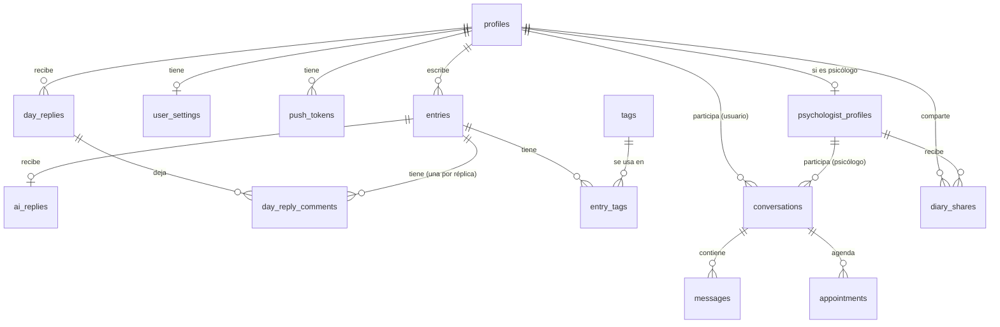

# Base de datos — Compartida entre app y web

> Este esquema es único para todo el producto. La web NO define su propio esquema — consume exactamente estas tablas y reglas, en el mismo proyecto de Supabase que usa la app. Contenido idéntico al documento original del equipo de app; se agrega solo la sección 0 de coordinación.

## 0. Coordinación de cambios (resuelve el pendiente "¿cómo maneja el equipo web los cambios a la base de datos?")

- Las migraciones de Supabase viven en un único repositorio compartido (`supabase/migrations/`), no duplicadas entre app y web.
- Ningún cambio de esquema se aplica directo a producción/staging sin que ambos equipos lo revisen — un cambio de columna o tabla que no rompe la app puede romper una pantalla web ya construida, y viceversa.
- Antes de construir una pantalla que dependa de una tabla nueva, confirmar con el equipo de app si ya existe una migración para ella o si hay que proponerla en conjunto.
- Sugerencia práctica: un canal o hilo compartido donde cualquiera de los dos avise antes de correr una migración nueva.

## Tablas

| Tabla | Qué guarda |
|---|---|
| `profiles` | Perfil de cada cuenta (una por usuario de Supabase Auth) y su rol: usuario o psicólogo |
| `psychologist_profiles` | Datos profesionales del psicólogo, estado de verificación y su link de Meet |
| `entries` | Las notas del diario |
| `ai_replies` | La réplica de la IA a la primera nota del día (una por nota, como máximo) |
| `day_replies` | La réplica del día (a la hora elegida) y la última réplica (a medianoche, solo si se escribió después de la del día): una fila por usuario, día y tipo, con qué notas leyó |
| `day_reply_comments` | El comentario propio que la réplica del día (o la última) le dejó a cada nota que leyó |
| `tags` | Etiquetas que se pueden poner a las notas |
| `entry_tags` | Qué etiquetas tiene cada nota (relación muchos a muchos) |
| `conversations` | Un chat entre un usuario y un psicólogo |
| `messages` | Los mensajes de cada chat |
| `appointments` | Sesiones coordinadas, con su link de Meet |
| `diary_shares` | Permisos: qué usuario comparte su diario con qué psicólogo, y si sigue activo |
| `user_settings` | Preferencias: recordatorio diario, tema, tono de la réplica y hora de la réplica del día (20:00 o 22:00) |
| `push_tokens` | Dispositivos para enviar notificaciones — en web, corresponde a las suscripciones de Web Push, no a un token nativo |

## Relaciones

## Reglas de acceso (Row Level Security)

Idénticas para app y web — las reglas viven en la base de datos, no en el cliente:

- **Notas, réplicas y etiquetas de notas:** solo las ve su dueño. Un psicólogo puede leerlas únicamente si hay un permiso activo en `diary_shares`.
- **Chats y mensajes:** solo los ven sus dos participantes.
- **Sesiones:** solo las ven el usuario y el psicólogo de esa conversación.
- **Perfiles de psicólogos:** cualquier usuario ve los verificados. Solo el dueño edita el suyo.
- **Verificación de psicólogos:** solo un administrador puede cambiarla.
- **Réplicas de la IA:** las escribe solo el servidor (Edge Function), nunca el cliente (ni app ni web). Vale para `ai_replies`, `day_replies` y `day_reply_comments`.
- **Réplicas del día y sus comentarios:** solo las ve su dueño; un psicólogo, igual que las notas, solo con permiso activo. Nunca leen notas privadas.

## Sin tabla propia

- **Métricas** (racha, total de notas y palabras, ánimo en el tiempo, etiquetas frecuentes): se calculan a partir de `entries` con consultas o vistas — la web reutiliza las mismas vistas/consultas que la app, no reinventa la lógica de cálculo.
- **Bloqueo (biométrico en app, WebAuthn/PIN en web):** vive en el cliente, no en la base de datos.
- **Dictado por voz:** se convierte a texto en el cliente (app o navegador); solo se guarda el texto en `entries`.

## Storage (archivos)

| Bucket | Contenido | Acceso |
|---|---|---|
| `avatars` | Fotos de perfil | Público de lectura |
| `credentials` | Documentos de verificación de psicólogos | Privado: el dueño y el administrador |

## Edge Functions (compartidas, un solo lugar)

| Función | Qué hace |
|---|---|
| `generate-reply` | Recibe una nota, pide la réplica a Gemini y la guarda en `ai_replies`. Incluye instrucción de seguridad: si la nota muestra riesgo, no da consejos y sugiere ayuda profesional |
| `generate-day-reply` | Trabajo programado. A la hora elegida de cada persona, si hubo al menos dos notas no privadas ese día, pide la réplica del día (respuesta general + comentario por nota, en JSON) y la guarda. A medianoche, réplica final si hubo notas después. Máximo tres llamadas a la IA por persona al día |

La web consume estas mismas funciones vía el cliente de Supabase — no se duplica la lógica de IA en el frontend web.

## A futuro (no en v1)

- Búsqueda por significado (pgvector).
- Tablas de pagos y planes.
