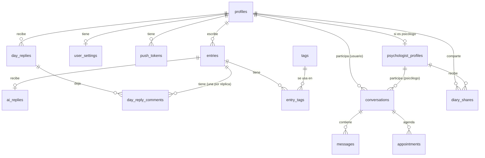

# Base de datos

> Este esquema es de la web, en su propio proyecto de Supabase (São Paulo, `sa-east-1`). Las migraciones viven en `supabase/migrations/`, y todo cambio pasa por una migración nueva. El detalle de columnas de las 19 tablas está en el diagrama entidad-relación (`entrega-evaluacion-3/fuentes/er.mjs`).

## Tablas

| Tabla | Qué guarda |
|---|---|
| `profiles` | Perfil de cada cuenta (una por usuario de Supabase Auth) y su rol: usuario o psicólogo |
| `psychologist_profiles` | Datos profesionales del psicólogo, estado de verificación y su link de Meet |
| `entries` | Las notas del diario |
| `ai_replies` | La réplica de la IA a la primera nota del día (una por nota, como máximo) |
| `day_replies` | La réplica del día (a la hora elegida) y la última réplica (a medianoche, solo si se escribió después de la del día): una fila por usuario, día y tipo, con qué notas leyó |
| `day_reply_comments` | El comentario propio que la réplica del día (o la última) le dejó a cada nota que leyó |
| `tags` | Etiquetas que se pueden poner a las notas |
| `entry_tags` | Qué etiquetas tiene cada nota (relación muchos a muchos) |
| `conversations` | Un chat entre un usuario y un psicólogo |
| `messages` | Los mensajes de cada chat |
| `appointments` | Sesiones coordinadas, con su link de Meet |
| `diary_shares` | Permisos: qué usuario comparte su diario con qué psicólogo, y si sigue activo |
| `user_settings` | Preferencias: recordatorio diario, tema, tono de la réplica y hora de la réplica del día (20:00 o 22:00) |
| `push_tokens` | Suscripciones de Web Push de cada navegador |
| `saved_phrases` | Las frases guardadas en el cofre |
| `daily_phrases` | Las frases del día |
| `ai_chats` | Los chats de la persona con la IA |
| `ai_chat_messages` | Los mensajes de cada chat con la IA |
| `help_resources` | Líneas de atención y contactos de emergencia por país, cada una con su fuente |

## Relaciones

## Reglas de acceso (Row Level Security)

Las reglas viven en la base de datos, no en el cliente, y cubren el 100 % de las tablas:

- **Notas, réplicas y etiquetas de notas:** solo las ve su dueño. Un psicólogo puede leer las notas no privadas únicamente si hay un permiso activo en `diary_shares`.
- **Chats y mensajes:** solo los ven sus dos participantes.
- **Sesiones:** solo las ven el usuario y el psicólogo de esa conversación.
- **Perfiles de psicólogos:** cualquier usuario ve los verificados por la vista `psychologist_directory`, que deja fuera el link personal y los datos de la solicitud. La tabla solo la leen su dueño y un administrador, y solo el dueño edita el suyo.
- **Verificación de psicólogos:** solo un administrador puede cambiarla.
- **Réplicas de la IA:** las escribe solo el servidor (Edge Function), nunca el cliente. Vale para `ai_replies`, `day_replies`, `day_reply_comments` y las respuestas de `ai_chat_messages`.
- **Réplicas del día y sus comentarios:** solo las ve su dueño. Nunca leen notas privadas.
- **Chats con la IA y cofre:** solo los ve su dueño.
- **Líneas de atención:** las lee cualquiera, incluso sin sesión; solo un administrador las cambia.

## Sin tabla propia

- **Métricas** (racha, total de notas y palabras, ánimo en el tiempo, etiquetas frecuentes): se calculan a partir de `entries`.
- **Bloqueo (PIN o llave de acceso):** vive en el navegador, no en la base de datos.
- **Dictado por voz:** se convierte a texto en el navegador; solo se guarda el texto en `entries`.
- **Exportar notas:** se genera al momento.

## Storage (archivos)

| Bucket | Contenido | Acceso |
|---|---|---|
| `avatars` | Fotos de perfil | Público de lectura |
| `credentials` | Documentos de verificación de psicólogos | Privado: el dueño y el administrador |

## Edge Functions

| Función | Qué hace |
|---|---|
| `generate-reply` | Recibe una nota, pide la réplica a Gemini y la guarda en `ai_replies`. Incluye instrucción de seguridad: si la nota muestra riesgo, no da consejos, sugiere ayuda profesional y enlaza a la ayuda en crisis |
| `generate-day-reply` | Trabajo programado. A la hora elegida de cada persona, si hubo al menos dos notas no privadas ese día, pide la réplica del día (respuesta general + comentario por nota, en JSON) y la guarda. A medianoche, réplica final si hubo notas después. Máximo tres llamadas a la IA por persona al día |
| `chat-with-ai` | El chat con Replica: guarda el mensaje de la persona y la respuesta de Gemini, con la misma instrucción de seguridad, `risk` y un límite de 20 mensajes al día (`take_chat_message`). Lee solo la conversación, nunca el diario. La web muestra la respuesta palabra por palabra |
| `delete-account` | Borra la cuenta y todo lo suyo, incluidos sus archivos |
| `set-role` | La decisión del administrador sobre una solicitud (aprobar, pedir cambios o rechazar). Guarda el historial con `review_application` y, al aprobar, pone `psychologist` en `app_metadata`. Comprueba que quien la llama sea `admin`; a cualquier otro le responde 403 |
| `send-reminders` | Trabajo programado del recordatorio diario (RF-53). Con su secreto, pide `due_reminders` y manda un aviso Web Push a cada navegador suscrito; borra las suscripciones que ya no existen. Necesita las claves VAPID |

La web las consume con el cliente de Supabase; la lógica de IA vive solo en el servidor.

## Área profesional

Además de las 19 tablas, lo que necesitan las pantallas de `DESIGN-WEB.md` §10:

| Cambio | Para qué |
|---|---|
| Rol en `app_metadata`: `user`, `psychologist` o `admin` | Quién audita las solicitudes. `profiles` lo refleja solo para leerlo; cambiarlo es cosa del servidor |
| `psychologist_profiles`: `university`, `status` (`pending`, `needs_changes`, `approved` o `rejected`), `status_reason`, `submitted_at`, `ethics_accepted_at` y `ethics_version`, y `availability` (`jsonb`: días, franjas y duración) | La solicitud completa, sus estados y la agenda. `meet_link` se queda donde está, pero se llena desde el panel |
| `verification_documents` (nueva): solicitud, ruta en `credentials`, nombre, peso, tipo y si fue reemplazado | Los PDF del título y de la colegiatura |
| `verification_reviews` (nueva): solicitud, administrador, acción, motivo y fecha | El historial de la auditoría (no se edita ni se borra) |
| `care_requests` (nueva): persona, psicólogo, mensaje, estado (`pending`, `accepted`, `declined` o `withdrawn`) y fechas | La solicitud de acompañamiento antes del chat |
| `clinical_notes` (nueva): psicólogo, paciente, texto y fechas | Las notas clínicas privadas. Solo las ve y las edita quien las escribió, y nunca la persona |
| `conversations`: `ended_by` (`user` o `psychologist`) | Saber quién terminó el proceso |
| `messages`: `entry_id` opcional | La nota suelta compartida en el chat (RF-44), que nunca puede ser privada |

Reglas de acceso nuevas:
- `verification_*`: el dueño ve las suyas y solo un `admin` las cambia.
- `care_requests`: las ven las dos partes. La persona la crea y la retira; el psicólogo la acepta o la declina.
- `clinical_notes`: solo su autor.
- **El visor del psicólogo lee solo `entries` no privadas**, con permiso activo. Las réplicas no se le muestran, aunque la regla general las permita.

## Lo que se agregó al implementar

Además de lo anterior, las migraciones traen lo que las reglas de producto necesitan en el servidor:

| Cambio | Para qué |
|---|---|
| `entries.day` | El día local de la persona al escribir. El servidor lo calcula con su zona horaria |
| `user_settings.timezone` | El día de cada nota y la hora de su réplica se cuentan en la zona de la persona. La web la envía al entrar, y una inválida pasa a `UTC` |
| `profiles`: `terms_version`, `terms_accepted_at` y `setup_done_at` | El consentimiento (RF-08) y si ya terminó la configuración inicial |
| `day_replies.entry_ids` | Qué notas leyó cada réplica. La última réplica lee solo las que faltaron |
| `daily_phrases.id` de texto | El mismo id de la biblioteca (`features/cofre/library.ts`), que guarda favoritos |
| `help_resources`: `source_url` y `checked_at` | Cada línea lleva su fuente oficial y la fecha en que se comprobó (RF-60). La lista llega en `20261103000001_ayuda_y_chat_con_la_ia.sql`, aprobada por la persona responsable; un país sin fila no muestra ningún número |
| `risk` en `ai_replies`, `day_replies` y `ai_chat_messages` | Lo escrito muestra riesgo (RF-61): la web enlaza a `/ayuda`. Lo marca Gemini y, como red, una lista de señales claras del servidor (`_shared/risk.ts`). `save_day_reply` lo recibe en la misma inserción |
| `ai_usage.chat_messages` | El límite diario del chat con Replica, en el día local de la persona. Desde esta migración, el cliente ya no inserta en `ai_chats` ni en `ai_chat_messages`: todo pasa por `chat-with-ai` |
| `ai_usage` (nueva): persona, día y llamadas | El límite de tres llamadas a la IA por persona al día (RF-20). Solo la toca el servidor, y una llamada que falla se devuelve |
| `psychologist_profiles.status` | Reemplaza a `verification_status` del diagrama |
| `user_settings`: `tutorials_seen` y `tutorials_skipped` | Los recorridos vistos son de la cuenta. Van aquí y no en `profiles`, que el psicólogo puede leer |
| `verification_reviews.documents` | Qué documentos pidió reemplazar el administrador en una subsanación |
| `conversations.psychologist_read_at` | Cada lado marca su propia lectura (`mark_conversation_read`): lo que lee la persona no cuenta para el psicólogo |
| `messages.event` | El tipo de aviso (aceptó, compartió, dejó de compartir, terminó), para que cada lado lo diga a su manera |
| `appointments.duration_minutes` | La duración de la sesión, la de la agenda del psicólogo |

El área profesional llega en `20261103000002_area_profesional.sql`:
- **Solicitud de verificación.** Se envía solo con `submit_application` (datos, documentos subidos y los que reemplaza) y se decide solo con `review_application`, desde `set-role`. Del perfil, el psicólogo cambia solo su agenda: uno aprobado ya no cambia su nombre ni su licencia.
- **Acompañamiento.** Se pide a un psicólogo aprobado (`is_approved_psychologist`), sin tener otro activo y con una sola solicitud pendiente. **Solo aceptar abre la conversación**, la nueva o la de antes con el mismo psicólogo, y deja el aviso. Las conversaciones ya no se crean desde el navegador.
- **Terminar.** `end_conversation` lo hace cualquiera de los dos y guarda `ended_by`; apaga el permiso del diario y deja el aviso.
- **Notas clínicas.** Solo su autor, sobre alguien que es o fue su paciente. Se quedan aunque el permiso del diario termine.
- **Tiempo real.** A la persona le llega la respuesta a su solicitud, y al psicólogo la solicitud nueva. Al suscribirse y al reconectarse, la web vuelve a traer el estado.

Las funciones restantes llegan en `20261104000001_funciones_restantes.sql`:
- **Nota suelta en el chat.** Un trigger de `messages` exige que la comparta la persona, que sea suya y no privada, y copia el texto de la nota: el navegador no puede mandar otro. El psicólogo lee esa nota (ánimo, tema y fecha) mientras la conversación sigue abierta, aunque no tenga el diario compartido; nunca su réplica.
- **Notas sin conexión.** `create_entry` recibe `p_written_at`, la hora en que se escribió. Se acepta hasta tres días atrás y nunca en el futuro; fuera de eso, cuenta ahora.
- **Recordatorio diario.** `register_push` guarda la suscripción de ese navegador (si la tenía otra cuenta, pasa a la nueva). Cada 15 minutos, `pg_cron` mira `due_reminders`: tiene el recordatorio puesto, ya pasó su hora hace menos de una hora, hoy no escribió y no lo recibió. `user_settings.reminder_sent_on` evita el segundo aviso del día.
- **Lo que no está en la base de datos:** el bloqueo con PIN o llave de acceso vive solo en el navegador, por cuenta, y la copia sin conexión en su IndexedDB. Cerrar sesión borra los dos.

Son 24 tablas, todas con RLS. Lo que no se ve en las tablas:

- **Una nota se crea solo con `create_entry`.** Exige ánimo y tema, y repetir el mismo id no la duplica. Un trigger decide `reply_mode`: el cliente solo dice si es privada. Del cliente, una nota solo cambia su favorita: no se edita ni se borra.
- **Permisos por columna.** Las reglas dicen qué filas; los `grant` dicen qué columnas. Nadie cambia su `role`, su `status` ni la privacidad de una nota.
- **Los mensajes de sistema los escribe el servidor.** Compartir el diario, dejar de compartirlo y agendar una sesión dejan su aviso en el chat por trigger. Terminar el proceso apaga el permiso sobre el diario, venga de quien venga.
- **La réplica del día es un trabajo programado.** Cada 15 minutos, `pg_cron` mira `due_day_replies`, y si a alguien le toca llama a `generate-day-reply` con su secreto. Lo que falla se reintenta en la próxima vuelta, hasta tres días atrás.
- **Borrar una cuenta de psicólogo** borra sus conversaciones en cascada, también del lado de la persona. Para una cuenta de prueba basta; con cuentas reales habría que conservar el historial de la persona.

Para los pasos con claves, ver `supabase/README.md`.

## A futuro

- Búsqueda por significado (pgvector).
- Tablas de pagos y planes.
